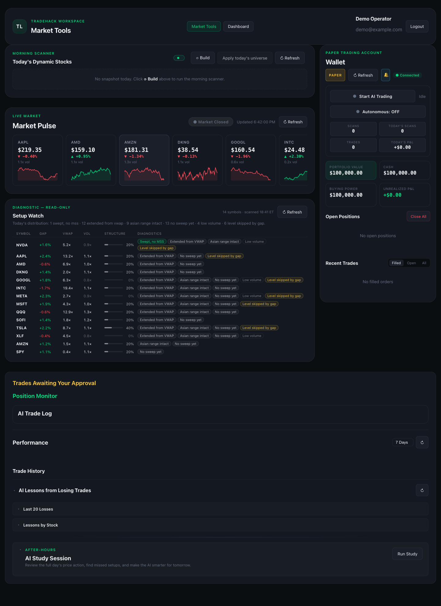
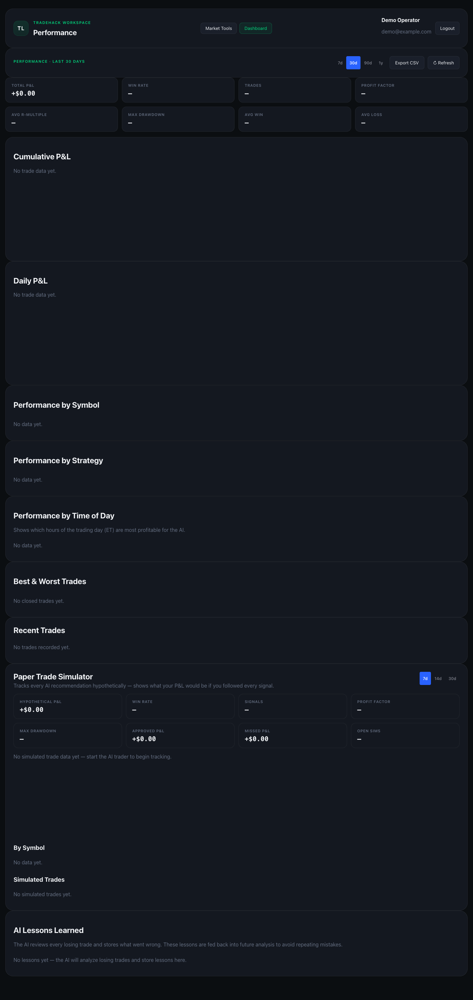

# TradeHack — stock day-trading scanner & paper autotrader

[](https://github.com/ParamvirSingh96/Day-Trading/actions/workflows/smoke.yml)


[](LICENSE)

TradeHack scans a watchlist of US stocks on 1-minute bars for a fixed playbook of
intraday setups, confirms them, sizes a position against a risk budget, places the
order on an **Alpaca paper account**, manages the exit in software, and records
everything for review — either with a human approving each trade from the
dashboard or fully unattended under an in-process scheduler.

It was built and run as a personal paper-trading system. It is a research and
execution tool, **not financial advice**, and it ships configured for paper
trading only.

---

## What it does

**Scan.** Every cycle during regular trading hours the autotrader pulls the last
8 hours of 1-minute bars for the active universe, computes indicators and ICT
features (liquidity sweeps, market-structure shifts, fair-value gaps, order
blocks, killzones, dealing ranges) and evaluates the live playbook:

| Strategy | Directions |
|---|---|
| ICT Judas Swing | long, short |
| ICT Turtle Soup | long, short |
| ICT Power of 3 | long, short |
| ICT Multi-Day Premium/Discount | long |

A second, informational "context" playbook (breaker blocks, Asian-range
breakouts, sweep + MSS, …) is surfaced in the UI but never auto-traded. Partially
formed setups are shown as *forming* so the operator can see what the scanner is
watching. An optional AI confidence gate (Claude pre-screen) exists behind
`ENABLE_AI_GATE`; by default the predicate scanner trades on its own.

**Confirm and execute.** A match must still hold after a 120-second confirmation
window, then becomes an approval card (expires in 120 s). The operator approves
it from the dashboard — or, with the **Autonomous** switch on, qualifying matches
are auto-approved up to a per-day cap. Execution passes a chain of gates (daily
loss circuit breaker, duplicate/max-open checks, sector cap, projected daily
loss, broker-truth reconciliation, market-hours, same-symbol cooldown) before a
sized market order is submitted. Position size is a 5 % risk budget scaled by
confidence, regime, calibration and news multipliers, capped by notional and
share limits.

**Manage.** A monitor loop checks open positions every 10 seconds: 0.5 % trailing
stop ratchet, 60-minute maximum hold, end-of-day flat 15 minutes before the
close. Positions are rehydrated from the broker after a restart.

**Review.** Every trade is persisted with its setup, confidence, fills (broker-true
P&L when fill persistence is on), exit reason and outcome. The performance
dashboard shows cumulative/daily P&L, breakdowns by symbol, strategy and hour,
best/worst trades, a paper-trade simulator and auto-generated lessons on losses.
A daily summary email goes out after the close.

**Run unattended.** The in-process scheduler builds the morning universe at
08:30 ET (an 82-symbol candidate pool screened for gap, news and sector flow,
merged onto a 23-symbol audited base), applies it, starts the autotrader at
09:30, stops it after the close and sends the summary. A readiness banner,
heartbeat, watchdog and failure-alert emails cover the operational gaps.

## Screenshots

Captured in `DEMO_MODE` (synthetic data, in-memory broker — no credentials).

| Workspace (`app.html`) | Performance dashboard (`dashboard.html`) |
|---|---|
|  |  |

## Pages

- `index.html` — public landing page
- `login.html` / `register.html` — account creation and login
- `app.html` — the workspace: morning scanner, market pulse, setup watch, account
  and autotrade controls, approvals, position monitor, trade log, performance,
  after-hours study, chart modal with AI analysis
- `dashboard.html` — performance analytics
- `analysis.html` — per-symbol chart with ICT overlay, AI analysis and quick trade

## Architecture

```
Frontend/            vanilla JS (ES modules) + HTML/CSS, no build step
  serve.py           stdlib static server with no-cache headers (port 3000)
Backend/app/         FastAPI (port 8000)
  main.py            app factory, lifespan (migrations, universe restore, scheduler,
                     Alpaca trade stream), CORS, rate limiting, routers, WebSocket
  routers/           auth · market (charts, analysis, morning universe, setup watch)
                     · trading (orders, autotrade, readiness, history, study)
  autotrade.py       scan → confirm → approve → execute → monitor loop
  strategies.py      the ICT playbook (predicates, weights, suspension notes)
  ict/               ICT feature detectors over bar lists
  scanner.py         multi-symbol pre-screen (thread pool)
  scheduler.py       daily build/apply/start/stop/summary automation
  screener_morning.py / applied_universe.py   morning universe build + apply
  alpaca.py          market-data + trading REST clients, trade-update stream
  analyzer.py        Claude chart analysis (optional), indicators
  readiness.py       operator readiness guard
  risk & state       trading_mode.py, trade_history.py, calibration.py, regime.py, …
Backend/scripts/     operational tools + smoke suites (see below)
deploy/              systemd units + rsync script for a Tailscale-only VM
docs/                operating runbook and decision records
```

Data flow: Alpaca minute bars → indicators + ICT features → playbook predicates →
confirmation → approval/autonomous → Alpaca paper order → software-managed exits
→ SQLite (`Backend/data/tradehack-dev.db`) → dashboard/WebSocket → email.

## Paper vs. live

The build is **paper-only by default and enforces it at the broker boundary,
not by label**: with `PAPER_ONLY=true` the trading client refuses to be
constructed for — or to send any order, cancel or close to — anything but
`https://paper-api.alpaca.markets` exactly (scheme, host, no port/path/userinfo),
the destination is re-validated before every mutation, a persisted "live" mode
is overridden on load, and the mode endpoint returns `403 paper_boundary`.
A live path still exists for a deliberately configured deployment and needs all
of: `PAPER_ONLY=false`, live credentials, the runtime mode switched to live, and
`LIVE_TRADING_ENABLED=yes` (re-checked per mutation). Design note: entries are
plain market orders and exits are managed by the in-process monitor (the broker
holds no resting stop unless the trailing stop is disabled), so a crashed
process leaves positions unmanaged until it restarts and rehydrates.

## Security hardening (October 2026)

A self-initiated security review of the finished app produced these changes,
each backed by regression tests in `tests/`:

| Finding | Fix | Proven by |
|---|---|---|
| Open registration gave any account the shared broker controls | Operator boundary: `User.is_operator`; registration **closed** by default (bootstrap account + `OPERATOR_EMAILS`); every account/order/position/autotrade/mode/market route and the WebSocket feed require an operator | `test_operator_boundary.py` — a logged-in non-operator gets 403 everywhere |
| Paper mode was a label; a "paper" config could point at the live host | Destination validation at client construction and before every mutation; `PAPER_ONLY` build flag | `test_paper_boundary.py` — label/host mismatches, scheme, port, userinfo, path smuggling and mid-process env flips are all refused with zero requests leaving the process |
| Analysis/dashboard text rendered via `innerHTML` without escaping | `esc()` applied consistently across all frontend modules | `test_frontend_escaping.py` — static guard that fails on any new unescaped interpolation |
| Broker rejections surfaced as generic 500s | Typed errors (`InvalidOrderRequest`, `OrderRejected`, `BrokerUnavailable`, `UncertainOutcome`) translated to 400/422/503/502 with structured bodies; mutations are never retried | `test_orders.py` — rejection, 5xx and timeout each map to the right status, exactly one attempt |
| Order prices unvalidated (negative, non-finite, wrong fields per type, inverted bracket legs) | Pydantic cross-field validators; non-finite tokens no longer crash the error encoder | `test_orders.py` — 15 invalid shapes rejected before the broker is contacted |
| WebSocket authenticated once, never re-checked; no Origin check | Origin allow-list, operator-only, session re-validated per message and every 30 s; logout/re-login close bound sockets | `test_ws_lifecycle.py` |
| PBKDF2 at 120k iterations | 600k iterations in a versioned hash format; legacy hashes verify and upgrade on next login | `test_password_hashing.py` |
| Unscanned, loosely pinned dependencies | `requirements.lock` + `pip-audit` job in CI (three advisories fixed by upgrading `python-multipart`, `starlette`, `anyio`) | CI `audit` job |

`DEMO_MODE=true` runs the whole app against an in-process fake broker with
synthetic bars (`app/fake_broker.py`) — the same fake the tests use — so a clean
checkout can be explored without any credentials.

## Setup

Requires **Python 3.14** (the pinned numpy/pandas wheels) and an Alpaca account
with a **paper** API key pair.

```bash
cd Backend
python3.14 -m venv venv
./venv/bin/pip install -r requirements.txt -c requirements.lock
cp .env.example .env          # add your Alpaca PAPER keys; optional AI/SMTP keys
./venv/bin/uvicorn app.main:app --host 127.0.0.1 --port 8000
```

No broker account yet? Set `DEMO_MODE=true` in `.env` and skip the keys — the
app serves synthetic data from an in-memory broker.

In a second terminal:

```bash
cd Frontend
python3 serve.py 3000
```

Open http://127.0.0.1:3000, register an account, log in, and you land in
`app.html`. The first account created on an empty database is the operator;
registration is closed after that unless `REGISTRATION_MODE=open` or the email
is listed in `OPERATOR_EMAILS`. `./start-lan.sh` starts both servers bound to
your LAN address so the dashboard works from a phone. For a 24/7 host see [deploy/DEPLOY.md](deploy/DEPLOY.md);
for the daily operating procedure see [docs/RUNBOOK.md](docs/RUNBOOK.md).

## Tests

Two layers, both run by GitHub Actions on every push (`.github/workflows/smoke.yml`):

- **pytest regression suite** (`tests/`) — the security boundaries above plus a
  complete demo workflow, all against the in-process fake broker:
  ```bash
  pip install -r Backend/requirements-dev.txt
  python -m pytest tests -q
  ```
- **seven smoke suites** covering the close lifecycle, crash-recovery
  reconciliation, entry guards, the AI gate, the full ICT playbook (188
  checks), the position cap and the RTH split:
  ```bash
  cd Backend
  for s in smoke_close_lifecycle smoke_close_recovery smoke_entry_guards \
           smoke_haiku_gate smoke_ict_v7_playbook smoke_position_cap smoke_rth_split; do
    ./venv/bin/python -m scripts.$s | tail -1
  done
  ```

A separate CI job runs `pip-audit` against the locked runtime dependencies.

## Operational scripts

| Script | Purpose |
|---|---|
| `scripts/build_morning_universe.py` | build the day's morning universe (the scheduler calls this at 08:30 ET) |
| `scripts/audit_universe_sources.py` | weekly/monthly audit of base vs. dynamic universe performance |
| `scripts/build_edge_lookup.py` | regenerate `data/edge_lookup_v710.json` (per-strategy edge stats) |
| `scripts/run_strategy_backtest.py` | replay the playbook over cached bars |
| `scripts/analyze_live_losses.py`, `analyze_slippage.py`, `dry_stretch_audit.py` | post-hoc analysis of the paper record |
| `scripts/launchd/` | macOS launchd job for the 08:30 build when not using the in-process scheduler |

## Status and known limitations

- Functionally complete as a paper day-trading system; no further feature work is
  planned. The October 2026 security pass (above) is the latest change set.
- Coverage is strongest at the boundaries the security review targeted; the
  autotrader's internal sizing and daily-loss logic is covered by the smoke
  suites rather than unit tests.
- The app is single-tenant by design: all operators share one configured broker
  account, and the deploy kit exposes it only over Tailscale.
- Several modules are large (`autotrade.py`, `strategies.py`) and carry their
  version history as in-line notes.
- Market-data bar caches and the trade database are runtime state and are not
  part of the repository.

## Disclaimer

This software is for research and paper trading. Nothing here is investment
advice, and trading real money with it is neither supported nor recommended.

## License

[MIT](LICENSE).
